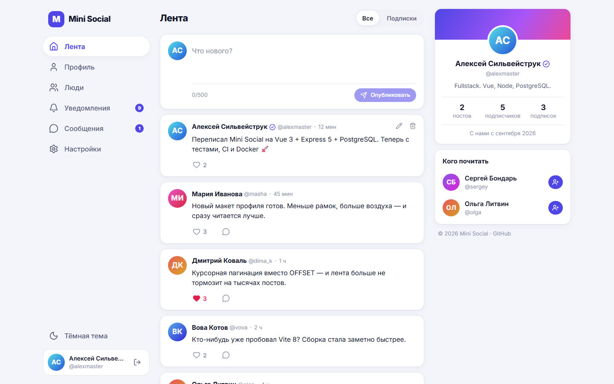
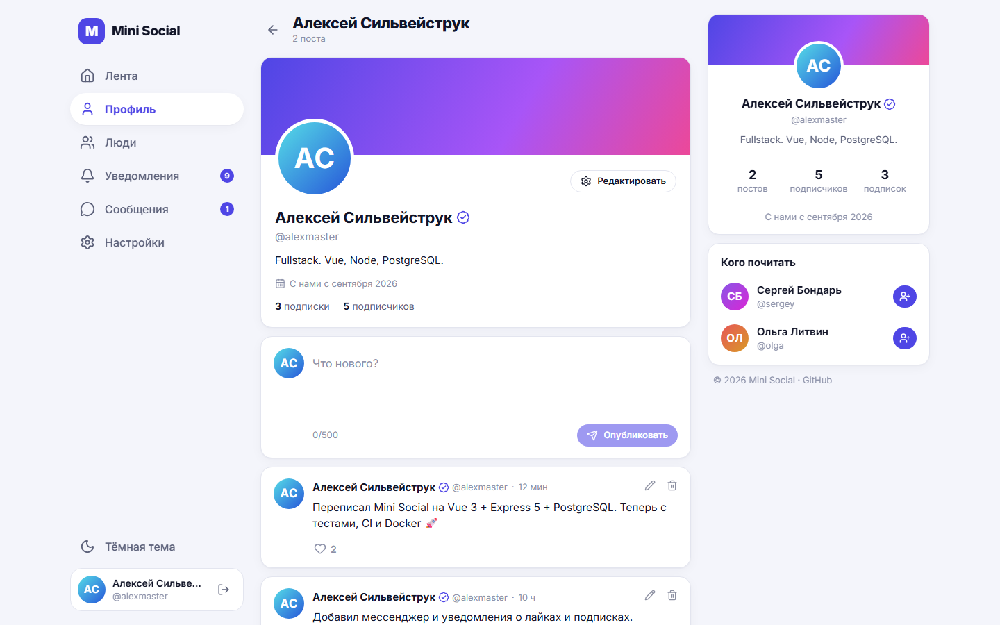
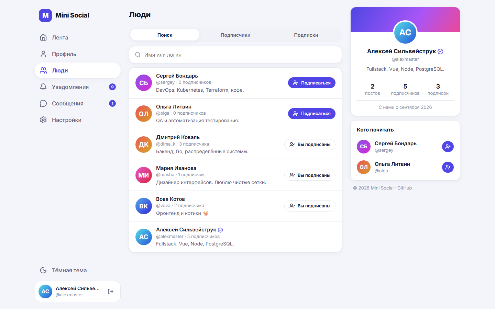
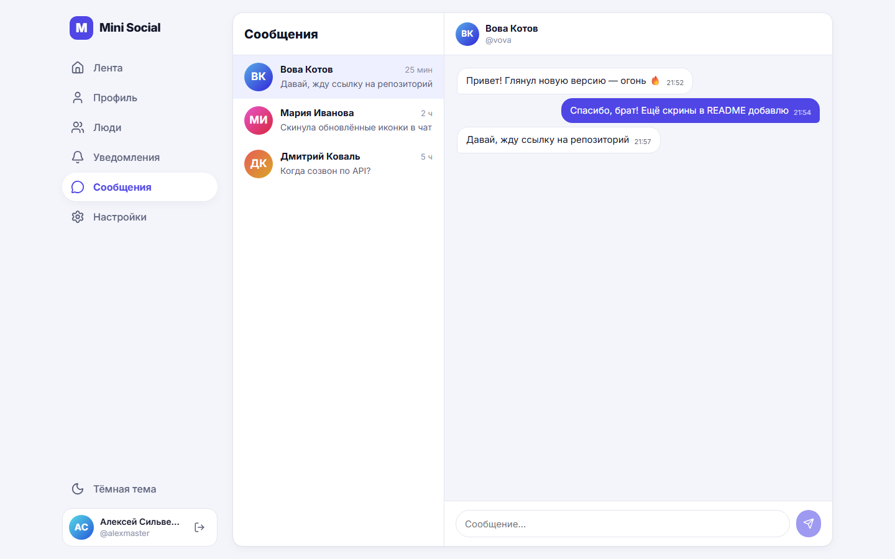
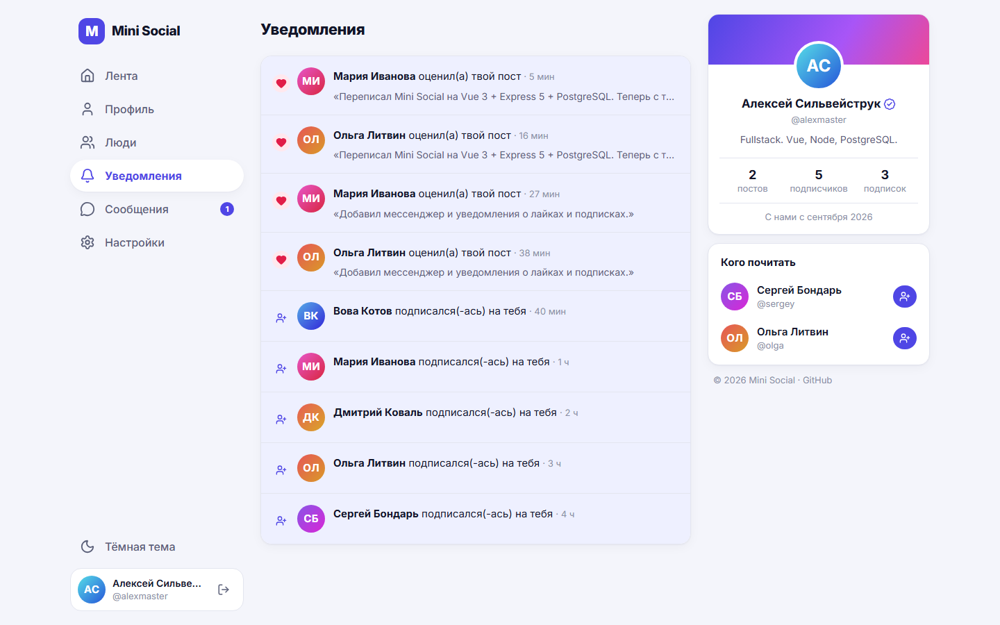
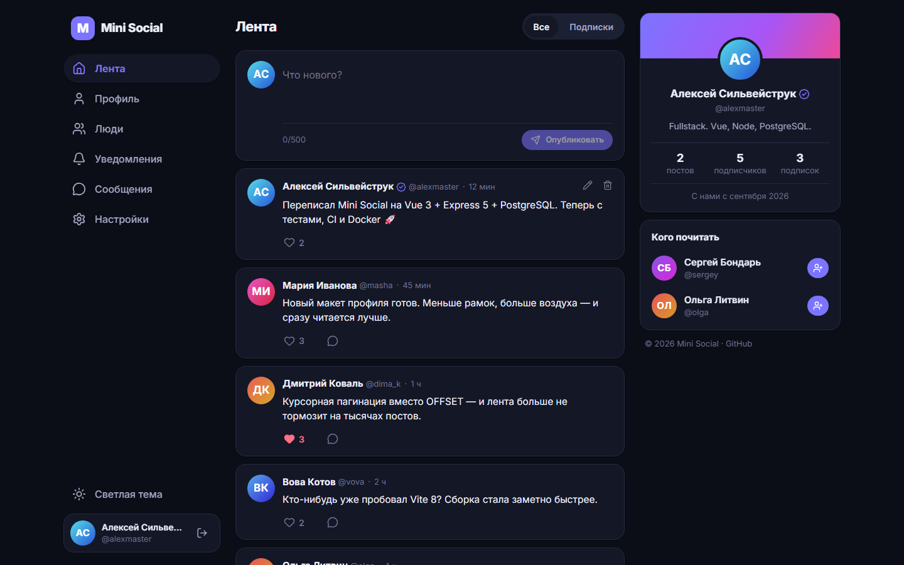
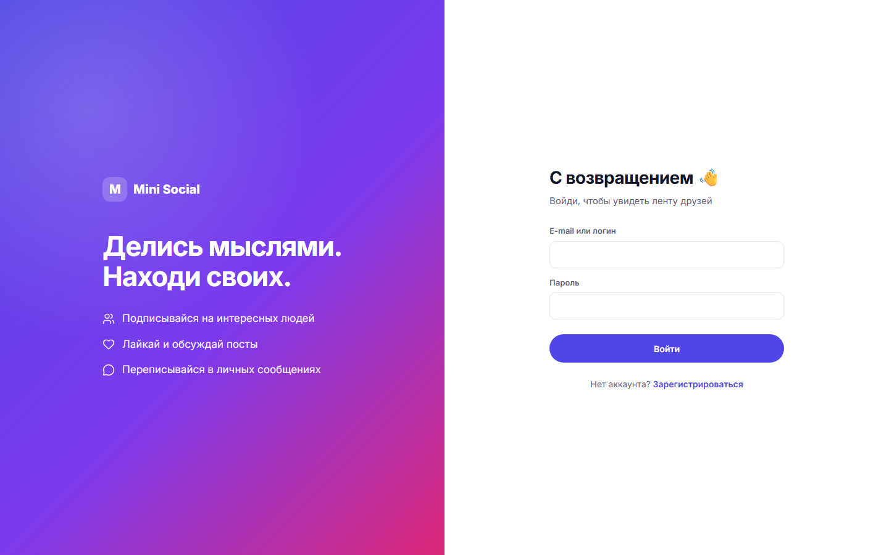
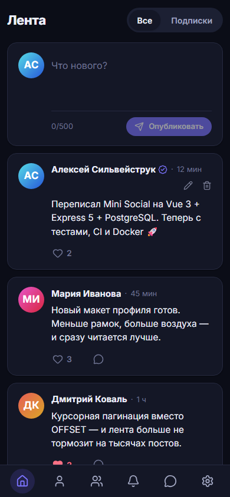
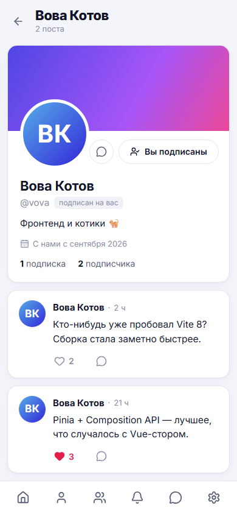

# Mini Social

[](https://github.com/AlexMaster168/mini-social/actions/workflows/ci.yml)


Небольшая социальная сеть: лента постов, подписки, лайки, уведомления и личные сообщения.
Монорепозиторий на **Vue 3 + Express 5 + PostgreSQL**, с тестами, CI и Docker-образом.



## Возможности

- **Аккаунты** — регистрация, вход по e-mail или логину, сессия в httpOnly-cookie, смена профиля и пароля, удаление аккаунта со всеми данными
- **Лента** — все посты или только подписки, курсорная пагинация, создание, редактирование и удаление своих постов
- **Лайки** — с оптимистичным обновлением интерфейса и уведомлением автору
- **Подписки** — подписчики и подписки любого пользователя, рекомендации «Кого почитать», поиск людей
- **Уведомления** — о лайках и новых подписчиках, счётчики непрочитанного в меню
- **Сообщения** — личные диалоги, непрочитанные сообщения, автообновление
- **Интерфейс** — светлая и тёмная темы, адаптивная вёрстка (на мобильных — нижняя панель навигации)

## Скриншоты

| Профиль                                        | Люди                                               |
| ---------------------------------------------- | -------------------------------------------------- |
|        |                |
| **Сообщения**                                  | **Уведомления**                                    |
|     |  |
| **Тёмная тема**                                | **Вход**                                           |
|  |                 |

<p align="center">
  
  &nbsp;&nbsp;
  
</p>

Скриншоты генерируются автоматически: `pnpm build && pnpm screenshots`.

## Стек

| Слой           | Технологии                                                                                   |
| -------------- | -------------------------------------------------------------------------------------------- |
| Фронтенд       | Vue 3.5 (Composition API, `<script setup>`), Vue Router 5, Pinia 4, Vite 8, TypeScript       |
| Бэкенд         | Node.js 22, Express 5, Drizzle ORM, Zod 4, JWT, bcrypt, Pino                                 |
| База данных    | PostgreSQL 18, миграции Drizzle Kit                                                          |
| Безопасность   | Helmet (CSP, HSTS), rate limiting, httpOnly + SameSite cookie, валидация всех входных данных |
| Тесты          | Vitest + Supertest (API на реальной БД), Vue Test Utils, Playwright (e2e)                    |
| Инфраструктура | pnpm workspaces, ESLint 10, Prettier, GitHub Actions, Docker, Dependabot                     |

## Быстрый старт

Нужны **Node.js 22+**, **pnpm 12** (`npm i -g pnpm@12` или `corepack enable`) и **PostgreSQL**.

```bash
git clone https://github.com/AlexMaster168/mini-social.git
cd mini-social
pnpm install

cp .env.example .env            # пароль БД по умолчанию — alexalex, поменяй JWT_SECRET
createdb -U postgres mini_social # или CREATE DATABASE mini_social; в psql

pnpm db:migrate                 # создать таблицы
pnpm db:seed                    # (опционально) демо-данные
pnpm dev                        # API на :3000, фронтенд на http://localhost:5173
```

Демо-аккаунт после `db:seed`: **`alexmaster` / `password123`** (у всех демо-пользователей тот же пароль).

### Через Docker

```bash
cp .env.example .env   # обязательно задай JWT_SECRET (минимум 32 символа)
docker compose up -d --build
```

Приложение откроется на <http://localhost:3000>: один контейнер отдаёт и API, и собранный фронтенд,
миграции применяются при старте. Порт меняется переменной `APP_PORT`.

## Переменные окружения

| Переменная       | По умолчанию        | Описание                                                    |
| ---------------- | ------------------- | ----------------------------------------------------------- |
| `DATABASE_URL`   | —                   | Строка подключения к PostgreSQL                             |
| `JWT_SECRET`     | —                   | Секрет для подписи сессий, минимум 32 символа               |
| `JWT_EXPIRES_IN` | `7d`                | Время жизни сессии                                          |
| `PORT`           | `3000`              | Порт API                                                    |
| `NODE_ENV`       | `development`       | `development` / `test` / `production`                       |
| `LOG_LEVEL`      | `info`              | Уровень логов Pino                                          |
| `CORS_ORIGIN`    | пусто               | Список origin через запятую, если фронтенд на другом домене |
| `COOKIE_SECURE`  | `true` в production | Cookie только по HTTPS                                      |
| `TRUST_PROXY`    | `false`             | Включить за reverse proxy (nginx, Render, Fly и т. п.)      |
| `WEB_DIST_DIR`   | `apps/web/dist`     | Откуда отдавать собранный фронтенд                          |

Переменные проверяются при старте (Zod) — с некорректной конфигурацией сервер не запустится.

## Скрипты

| Команда            | Что делает                                                      |
| ------------------ | --------------------------------------------------------------- |
| `pnpm dev`         | API (tsx watch) и Vite dev server параллельно                   |
| `pnpm build`       | Сборка API (tsc) и фронтенда (vue-tsc + Vite)                   |
| `pnpm start`       | Запуск собранного API (он же отдаёт фронтенд)                   |
| `pnpm db:generate` | Сгенерировать миграцию после изменения `schema.ts`              |
| `pnpm db:migrate`  | Применить миграции                                              |
| `pnpm db:seed`     | Очистить БД и заполнить демо-данными                            |
| `pnpm lint`        | ESLint                                                          |
| `pnpm format`      | Prettier                                                        |
| `pnpm typecheck`   | Проверка типов во всех пакетах                                  |
| `pnpm test`        | Юнит- и API-тесты (нужна БД `mini_social_test`)                 |
| `pnpm test:e2e`    | Playwright e2e (после `pnpm build`, нужна БД `mini_social_e2e`) |
| `pnpm screenshots` | Перегенерировать скриншоты для README                           |

## Тесты

- **API** (`apps/server/test`) — интеграционные тесты на настоящем PostgreSQL: перед прогоном схема
  пересоздаётся и применяются миграции. Проверяются авторизация, права (нельзя править чужие посты),
  пагинация, подписки, уведомления, сообщения, удаление аккаунта.
- **Фронтенд** (`apps/web/src/**/*.test.ts`) — утилиты форматирования и компоненты (оптимистичный
  лайк с откатом при ошибке).
- **E2E** (`e2e/`) — Playwright против production-сборки: регистрация, посты, лайки, подписки,
  переписка, редиректы для гостей.

```bash
createdb -U postgres mini_social_test
createdb -U postgres mini_social_e2e
pnpm test
pnpm build && pnpm exec playwright install chromium && pnpm test:e2e
```

## CI

GitHub Actions (`.github/workflows/ci.yml`) на каждый push и pull request:

1. **check** — Prettier, ESLint, typecheck, юнит- и API-тесты с PostgreSQL 18 в service-контейнере, сборка
2. **e2e** — Playwright на production-сборке; при падении отчёт сохраняется в артефакты
3. **docker** — сборка Docker-образа с кэшем слоёв

Dependabot раз в неделю предлагает обновления npm-пакетов и GitHub Actions.

## API

Все эндпоинты под `/api`, ответы в JSON, ошибки в формате `{ "error": { "message", "details?" } }`.
Всё, кроме `auth/*` и `health`, требует авторизации.

| Метод                      | Путь                                 | Описание                                    |
| -------------------------- | ------------------------------------ | ------------------------------------------- |
| `GET`                      | `/health`                            | Проверка API и соединения с БД              |
| `POST`                     | `/auth/register`, `/auth/login`      | Регистрация / вход (ставит cookie)          |
| `POST`                     | `/auth/logout`                       | Выход                                       |
| `GET`                      | `/auth/me`                           | Текущий пользователь                        |
| `GET`                      | `/users?q=`                          | Поиск по имени и логину                     |
| `GET`                      | `/users/suggestions`                 | Рекомендации, на кого подписаться           |
| `GET`                      | `/users/by-username/:username`       | Профиль со счётчиками и статусом подписки   |
| `GET`                      | `/users/:id/followers`, `/following` | Подписчики / подписки                       |
| `POST` / `DELETE`          | `/users/:id/follow`                  | Подписаться / отписаться                    |
| `PATCH`                    | `/users/me`                          | Изменить имя, логин, e-mail, «о себе»       |
| `PUT`                      | `/users/me/password`                 | Сменить пароль                              |
| `DELETE`                   | `/users/me`                          | Удалить аккаунт                             |
| `GET`                      | `/posts?scope=&author=&cursor=`      | Лента (`all` / `following`) с курсором      |
| `POST`                     | `/posts`                             | Создать пост                                |
| `GET` / `PATCH` / `DELETE` | `/posts/:id`                         | Пост; изменить и удалить может только автор |
| `POST` / `DELETE`          | `/posts/:id/like`                    | Лайк / снять лайк                           |
| `GET`                      | `/notifications`                     | Уведомления                                 |
| `POST`                     | `/notifications/read-all`            | Отметить всё прочитанным                    |
| `GET`                      | `/notifications/counters`            | Непрочитанные уведомления и сообщения       |
| `GET`                      | `/messages/conversations`            | Список диалогов                             |
| `GET` / `POST`             | `/messages/:userId`                  | История диалога / отправить сообщение       |

## Структура

```
apps/
  server/                 Express API
    drizzle/              SQL-миграции
    src/
      config/env.ts       валидация переменных окружения
      db/                 схема, подключение, миграции, сид
      middleware/         авторизация, обработка ошибок
      modules/            auth, users, posts, notifications, messages
    test/                 интеграционные тесты API
  web/                    Vue SPA
    src/
      api/                типизированный клиент API
      components/         layout, посты, карточки пользователей
      stores/             Pinia: сессия, счётчики, тосты
      views/              страницы
e2e/                      Playwright-тесты и генератор скриншотов
docs/screenshots/         скриншоты для README
```

## Деплой

Образ из `Dockerfile` самодостаточен: нужен только PostgreSQL и переменные окружения.
Запускай за HTTPS (cookie сессии помечены `Secure`, CSP включает `upgrade-insecure-requests`);
если перед приложением стоит reverse proxy — выставь `TRUST_PROXY=true`, чтобы rate limiting видел реальные IP.

## Авторы

Алексей Сильвейструк ([@AlexMaster168](https://github.com/AlexMaster168)).
Версия 2.0 переписана с нуля: новая архитектура, PostgreSQL вместо MongoDB, тесты, CI, Docker.

## Лицензия

[MIT](LICENSE)
